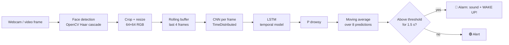
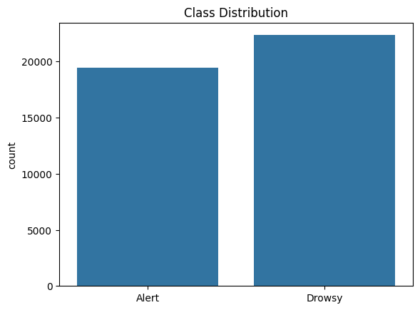
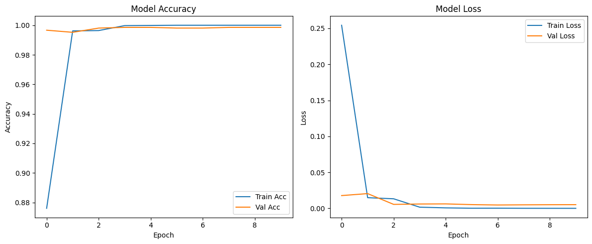

<div align="center">

# 😴 Driver Drowsiness Detection

**Real-time drowsiness detection from a webcam, using a CNN-LSTM that looks at short sequences of face frames.**

[](https://github.com/Osama-kn/ddd/actions/workflows/ci.yml)


[](LICENSE)
[](https://colab.research.google.com/github/Osama-kn/ddd/blob/main/notebooks/DDD.ipynb)

</div>

Drowsy driving is a factor in a large share of road accidents, and the warning signs (heavy eyelids, long blinks, a drooping head) are visible on the driver's face seconds before an accident. This project watches the driver through a regular webcam, classifies each moment as **Alert** or **Drowsy**, and raises a visual and audible alarm when drowsiness persists.

Instead of judging single images, the model reads a **sliding window of consecutive face crops**: a CNN extracts features from each frame and an LSTM models how they change over time, which is what separates a normal blink from eyes that stay closed.

## ✨ Features

- **Real-time detection** on a webcam or any video file, with a live overlay (face box, drowsiness gauge, FPS).
- **CNN-LSTM** temporal model built with TensorFlow / Keras.
- **Stable alerts**: predictions are smoothed with a moving average, and the alarm only fires after drowsiness lasts longer than a set time (1.5 s by default), so a single blink never triggers it.
- **Audible alarm** on macOS, Windows and Linux, plus a full-screen visual warning.
- **Honest evaluation**: validation on drivers the model has never seen (subject-wise split), with a confusion matrix, per-class metrics and training curves written to `reports/`.
- **Simple CLI**: `train`, `detect` and `predict` from a single `main.py`.
- **Record demos**: save the annotated stream to an `.mp4` with `--output`.
- Unit-tested core logic and CI with GitHub Actions.

## 🧠 How it works



### Model

| Stage | Layers | Output per sequence |
| --- | --- | --- |
| Input | 4 consecutive face crops | `4 × 64 × 64 × 3` |
| Spatial features (per frame) | 4 × [Conv2D 3×3 (32→64→128→128, ReLU) + MaxPool 2×2] | `4 × 4 × 4 × 128` |
| Flatten + Dropout 0.3 | per frame | `4 × 2048` |
| Temporal model | LSTM (64 units) + Dropout 0.5 | `64` |
| Classifier | Dense softmax | `[P(Alert), P(Drowsy)]` |

About 0.78 M parameters (~3 MB), small enough for real-time CPU inference on a laptop. Trained with Adam, categorical cross-entropy, class weighting, early stopping and learning-rate reduction on plateau.

## 📊 Dataset

[**Driver Drowsiness Dataset (DDD)**](https://www.kaggle.com/datasets/ismailnasri20/driver-drowsiness-dataset-ddd) on Kaggle: **41,793** RGB face crops extracted from videos of real people, in two classes.

| Class | Folder | Images |
| --- | --- | --- |
| Alert (label 0) | `Non Drowsy` | 19,445 |
| Drowsy (label 1) | `Drowsy` | 22,348 |

<p align="center"></p>

File names such as `A0001.png` are an alphabetic prefix followed by a frame number. The pipeline treats the prefix as the subject / source-video id. That is what lets it build sequences of **consecutive frames of the same person** and keep each subject entirely in either the training or the validation set.

## 📈 Results

### Prototype (Colab notebook)

The first model was trained in [`notebooks/DDD.ipynb`](notebooks/DDD.ipynb) (4-frame CNN-LSTM, 64×64, 10 epochs) and reached **99.86 % validation accuracy**.

<p align="center"></p>

> [!NOTE]
> That number is optimistic, and it is worth explaining why. The notebook splits **individual images** at random, so near-identical frames of the same driver end up in both train and validation. Its "sequences" are also groups of shuffled images rather than consecutive frames. The model can score highly by recognising people instead of drowsiness.

### Production pipeline

`python main.py train` fixes both issues:

- **Subject-wise split** (`--split subject`, the default): validation drivers are never seen during training. This estimates how the system behaves for a new driver.
- **Real temporal sequences**: sliding windows over consecutive frames of one subject.

Each run writes `reports/metrics.json` (accuracy, per-class precision/recall/F1, confusion matrix, train/val subjects), `reports/confusion_matrix.png` and `reports/training_curves.png`. To compare with the prototype's leaky setup, run it again with `--split random`.

## 🚀 Getting started

### 1. Install

Requires Python 3.10–3.12.

```bash
git clone https://github.com/Osama-kn/ddd.git
cd ddd
python -m venv .venv && source .venv/bin/activate   # Windows: .venv\Scripts\activate
pip install -r requirements.txt
```

> On Apple Silicon you can add `pip install tensorflow-metal` for GPU acceleration.

### 2. Download the dataset

With the [Kaggle CLI](https://www.kaggle.com/docs/api) (needs `~/.kaggle/kaggle.json`):

```bash
kaggle datasets download -d ismailnasri20/driver-drowsiness-dataset-ddd -p data --unzip
```

You can also download the zip from the Kaggle page and extract it into `data/`. The loader finds the `Drowsy` / `Non Drowsy` folders automatically.

### 3. Train

```bash
python main.py train --data data
```

This saves the best model to `models/ddd_cnn_lstm.keras` and the evaluation report to `reports/`. Training on CPU takes a while, so you can also train in Colab with the notebook.

### 4. Run real-time detection

```bash
python main.py detect                         # default webcam, default model
python main.py detect --source 1              # another camera
python main.py detect --source drive.mp4      # a video file
python main.py detect --output demo.mp4       # also save the annotated video
```

Press **q** to quit. A model exported from the Colab notebook (`.h5`) works too:

```bash
python main.py detect --model cnn_lstm_drowsiness_model.h5
```

### 5. Classify images

```bash
python main.py predict path/to/face.png        # single image (treated as a static clip)
python main.py predict path/to/frames_folder/  # consecutive frames, sliding window
```

## ⚙️ CLI reference

| Command | Option | Default | Description |
| --- | --- | --- | --- |
| `train` | `--data` | required | Dataset folder |
| | `--epochs` / `--batch-size` | 15 / 32 | Training length and batch size |
| | `--timesteps` | 4 | Frames per sequence |
| | `--stride` | 2 | Step between sliding windows |
| | `--split` | `subject` | `subject` (unseen drivers) or `random` (image-level) |
| | `--val-fraction` | 0.2 | Share of subjects / sequences held out |
| | `--model` / `--reports` | `models/…keras` / `reports/` | Output locations |
| `detect` | `--source` | `0` | Webcam index or video path |
| | `--threshold` | 0.6 | Smoothed drowsiness probability that counts as drowsy |
| | `--alarm-after` | 1.5 | Seconds of continuous drowsiness before the alarm |
| | `--smoothing` | 8 | Number of predictions in the moving average |
| | `--no-sound` / `--no-display` | off | Visual-only alert / run without a window |
| | `--output` | — | Save the annotated video |
| `predict` | `inputs…` | required | Image files and/or folders of frames |

## 🗂️ Project structure

```
ddd/
├── main.py                  # CLI: train | detect | predict
├── drowsiness/
│   ├── config.py            # shared constants (image size, timesteps, class order)
│   ├── data.py              # dataset discovery, sequences, subject-wise split
│   ├── model.py             # CNN-LSTM definition and model loading
│   ├── train.py             # training loop, metrics, plots
│   ├── detector.py          # real-time detection, smoothing, alarm, overlay
│   └── predict.py           # offline prediction on images / frame folders
├── notebooks/DDD.ipynb      # original Colab exploration and prototype
├── tests/                   # unit tests (no TensorFlow required)
├── docs/images/             # figures used in this README
└── .github/workflows/ci.yml # lint + tests on every push
```

## 🛠️ Design decisions

- **Temporal model over single frames**: a closed eye in one frame may be a blink; the same eye over several frames is not. The LSTM sees motion, the smoothing and alarm delay add stability on top.
- **One source of truth for preprocessing**: size, timesteps and class order live in `config.py`, and the detector reads the input shape from the loaded model. Training and inference can't drift apart (the cause of a label-order bug in the first version).
- **Memory-efficient training**: images stay in `uint8` (~0.5 GB for the whole dataset) and are scaled per batch, instead of a 2 GB float array.
- **Testable core**: the detector takes any prediction function and an injectable clock, so the alarm timing is unit-tested without a camera or TensorFlow.

## 🧭 Limitations & roadmap

- The face detector (Haar cascade) needs a reasonably frontal, well-lit face. It struggles at night, with strong head turns or with sunglasses.
- DDD has a limited number of subjects. More diverse data (lighting, ethnicity, glasses, IR cameras) would improve how well it generalises.
- Planned:
  - [ ] Eye Aspect Ratio / PERCLOS features with MediaPipe Face Mesh, fused with the CNN-LSTM score
  - [ ] Yawn detection (mouth aspect ratio)
  - [ ] TensorFlow Lite export for Raspberry Pi / in-car hardware
  - [ ] Infrared camera support for night driving
  - [ ] Pretrained model published as a release asset

> [!WARNING]
> This is a research / portfolio project, not a certified safety device. Never rely on it to stay awake behind the wheel: if you feel tired, stop and rest.

## 🙏 Acknowledgements

- Dataset: [Driver Drowsiness Dataset (DDD)](https://www.kaggle.com/datasets/ismailnasri20/driver-drowsiness-dataset-ddd) by `ismailnasri20` on Kaggle. Check its page for licence and citation details before redistributing the data.
- Built with [TensorFlow](https://www.tensorflow.org/), [OpenCV](https://opencv.org/) and [scikit-learn](https://scikit-learn.org/).

## 📄 License

[MIT](LICENSE) © Oussama Knouz

---

<div align="center">

**Oussama Knouz** · Senior backend & full-stack engineer · [illutec.com](https://illutec.com) · [@Osama-kn](https://github.com/Osama-kn)

</div>
